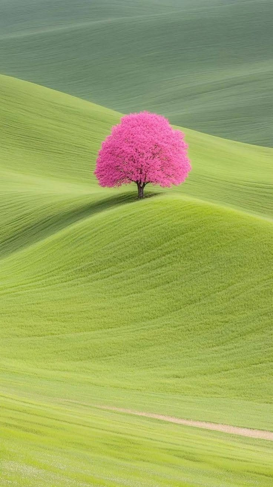
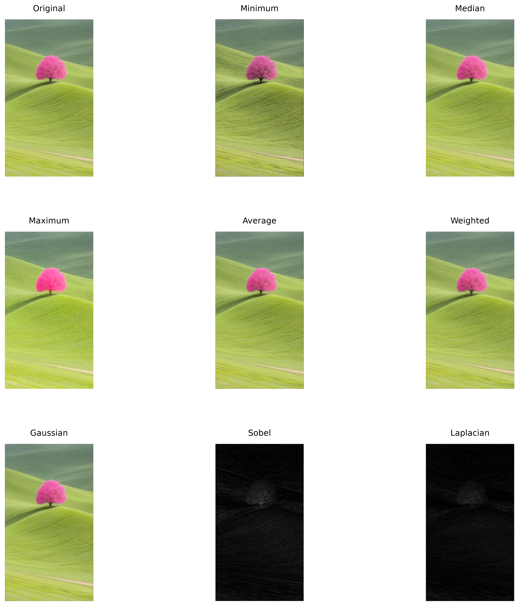
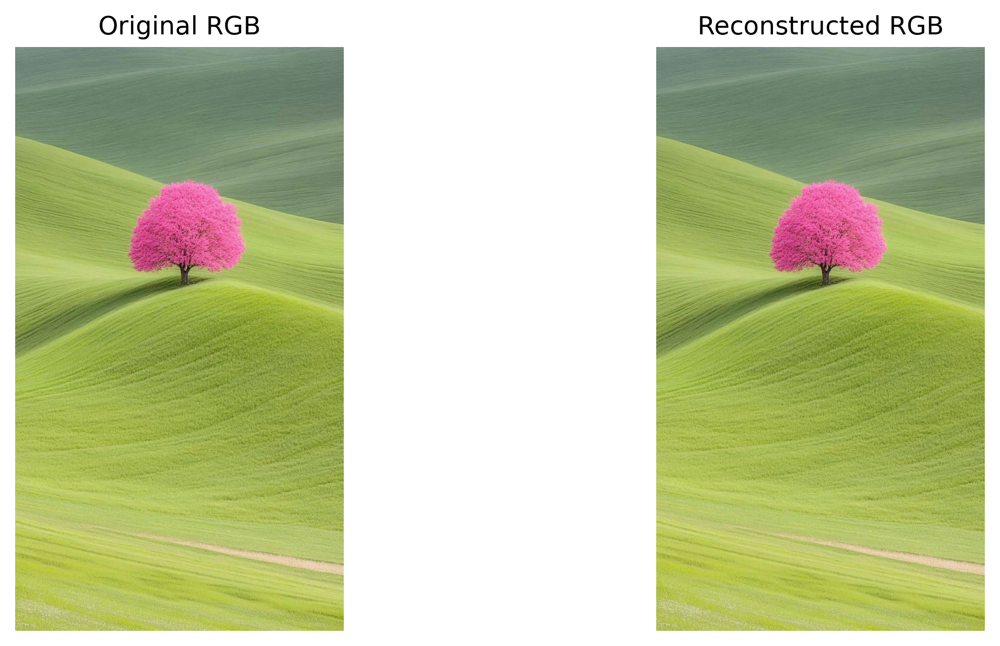
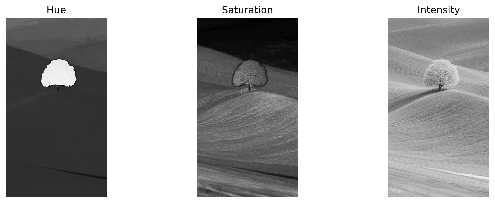

# Digital Image Processing

## Algorithms Used

- Spatial Filtering: Minimum, Median, Maximum, Average, Weighted Average, Gaussian, Sobel and Laplacian.
- RGB to HSI Conversion and HSI to RGB Reconstruction.
- Arithmetic Encoding and Decoding.

## Input Images

### Spatial Filtering Input

### Huffman Encoding Input

### Arithmetic Coding Input

### HSI Conversion Input

## Output Images

### Spatial Filtering Results

### Huffman Encoding Results

### Arithmetic Encoding Reconstruction

### RGB to HSI Conversion Results

### HSI Channels

